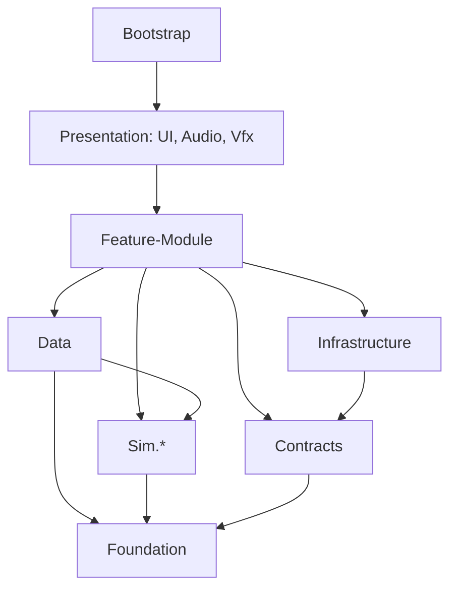

# Architecture Reference

Projekt: My Bush Plane (Codename im Code: `Bush`)
Stand: 21.11.2026, Version 0.1 (Vorschlag für M0)
Gilt für: Unity `6000.6.9f1`, URP, nur PC, Einzelspieler

## 1. Zweck und Pflege

Dieses Dokument ist eine Karte, kein Handbuch. Es beantwortet vier Fragen: Wo liegt was, wer darf wen kennen, wie heißen Dinge, und welche Muster gelten überall. Alles Weitere steht im Code oder in einem ADR.

Regeln für das Dokument selbst:

- Maximal ca. 4 Seiten. Wird es länger, wandert Detail in ein ADR oder in `docs/design/`.
- Änderungen an Modulgrenzen, Layern oder Konventionen laufen über einen Pull Request, der dieses Dokument mit ändert.
- Einzelne Entscheidungen mit Begründung stehen in `docs/adr/` (siehe Abschnitt 10). Hier steht nur das Ergebnis.
- Gilt etwas nicht mehr, wird es gelöscht und nicht durchgestrichen.

## 2. Leitprinzipien

1. **Simulation und Unity trennen.** Spiellogik (Fluide, Motor, Elektrik, Assembly-Graph, Atmosphäre, Wirtschaft) ist reines C# ohne `UnityEngine`. MonoBehaviours sind dünne Hüllen, die Eingaben weiterreichen und Zustand darstellen.
2. **Daten statt Typen.** Es gibt keine Klasse `Cessna` oder `Pickup`. Fahrzeuge sind Assemblies aus Parts mit Funktions-Tags. Verhalten entsteht aus den installierten Parts.
3. **Abhängigkeiten zeigen nur nach unten.** Höhere Layer dürfen tiefere kennen, nie umgekehrt. Kommunikation nach oben läuft über Events.
4. **Laufzeitzustand nie in ScriptableObjects.** ScriptableObjects sind zur Laufzeit schreibgeschützt. Veränderlicher Zustand liegt in eigenen State-Klassen.
5. **Alles Speicherbare hat eine `PersistentId`.** Persistenz wird von Anfang an mitgedacht, nicht nachgerüstet.
6. **SI-Einheiten intern.** Meter, Kilogramm, Sekunde, Newton, Pascal, Kelvin. Umrechnung nur an den Rändern (UI, Debug).
7. **Jedes Feature funktioniert mit Maus und Tastatur sowie Gamepad.** Von Anfang an, nicht am Ende.
8. **Messen vor Optimieren.** Systeme mit Label `performance` haben ein Budget und eine Messung im Issue.

## 3. Repository-Layout

Das Unity-Projekt liegt in einem Unterordner, damit Dokumentation, Werkzeuge und CI neben dem Projekt Platz haben.

```
my-bush-plane/                  Git-Repository
├── .github/
│   ├── workflows/              CI (GameCI: Tests und Build)
│   ├── ISSUE_TEMPLATE/
│   └── pull_request_template.md
├── docs/
│   ├── ARCHITECTURE.md         dieses Dokument
│   ├── adr/                    Architecture Decision Records
│   ├── design/                 Design-Dokumente (z. B. Spielschleife, Progression)
│   └── performance.md          Budgets und Messprotokolle
├── Tools/                      Skripte außerhalb von Unity (Blender-Export, CSV-Aufbereitung)
├── My Bush Plane/              Unity-Projekt (Projektwurzel für Unity Hub und GameCI)
│   ├── Assets/
│   ├── Packages/
│   └── ProjectSettings/
├── .editorconfig
├── .gitattributes
├── .gitignore
├── README.md
└── THIRD_PARTY_NOTICES.md      Lizenzen (u. a. MIT-Hinweis für Aircraft-Physics)
```

## 4. Unity-Projekt-Layout

```
/Assets/
├── _Project/                   alles Eigene (Unterstrich sortiert nach oben)
│   ├── Code/                   ein Ordner pro Assembly, asmdef in der Ordnerwurzel
│   │   ├── Foundation/
│   │   ├── Contracts/
│   │   ├── Sim.Assembly/
│   │   ├── Sim.Machinery/
│   │   ├── Sim.Environment/
│   │   ├── Sim.Gameplay/
│   │   ├── Data/
│   │   ├── Infrastructure/
│   │   ├── Interaction/
│   │   ├── Player/
│   │   ├── Items/
│   │   ├── Building/
│   │   ├── Vehicles/
│   │   ├── Aircraft/
│   │   ├── GroundVehicles/
│   │   ├── World/
│   │   ├── Weather/
│   │   ├── Rendering/
│   │   ├── Gameplay/
│   │   ├── UI/
│   │   ├── Audio/
│   │   ├── Vfx/
│   │   ├── Bootstrap/
│   │   └── Editor/             Editor-only Werkzeuge (Part-Importer, Validatoren)
│   ├── Tests/
│   │   ├── EditMode/           Tests für Foundation, Sim.*, Editor-Werkzeuge
│   │   └── PlayMode/           Integrationstests (Interaktion, Physik, Save/Load)
│   ├── Content/                Modelle, Materialien, Prefabs, nach Fachgebiet
│   │   ├── Items/              ItemDefinitions und Prefabs
│   │   ├── Parts/<Kategorie>/  PartDefinitions und Prefabs (Engine, Airframe, Gear, Electrical ...)
│   │   ├── Vehicles/Aircraft/<Name>/
│   │   ├── Vehicles/Ground/<Name>/
│   │   ├── World/              Terrain, Gebäude, Props, Vegetation
│   │   ├── Audio/
│   │   ├── Vfx/
│   │   └── UI/                 UXML, USS, Themes, Fonts, Icons
│   ├── Data/                   ScriptableObject-Instanzen ohne Content-Bezug
│   │   ├── Fluids/
│   │   ├── PartTags/
│   │   ├── Weather/
│   │   ├── Progression/
│   │   └── Input/              Input Actions Asset
│   ├── Scenes/
│   │   ├── Bootstrap.unity     einzige Startszene
│   │   ├── Testbeds/           Playground und Spezial-Testszenen
│   │   └── World/              Spielwelt (später Chunks)
│   └── Settings/               URP-Assets, Quality, Volume-Profile
└── ThirdParty/                 Fremdcode und Asset-Store-Pakete (je Paket ein Ordner)
    └── AircraftPhysics/        mit eigener asmdef
```

Regeln:

- Nichts Eigenes außerhalb von `_Project`. Nichts Fremdes innerhalb.
- Code und Content sind getrennt. Ein Prefab liegt in `Content`, sein Skript in `Code`.
- Pro Part-Prefab ein Ordner mit Prefab, Mesh, Material, Definition. So lässt sich ein Part verschieben oder löschen, ohne Streuverluste.
- Szenen bleiben klein. Spielobjekte werden aus Prefabs zusammengesetzt, nicht in der Szene gebaut.

## 5. Assemblies und Layer

### 5.1 Namenskonvention

- Root-Namespace: `MaintGames.Bush`. Der Codename `Bush` ist bewusst nicht der Spieltitel, damit eine Titeländerung keine Umbenennung im Code auslöst.
- Assembly-Name = Namespace des Ordners: `MaintGames.Bush.Sim.Machinery`.
- Unterordner innerhalb einer Assembly sind Unter-Namespaces: `Code/Sim.Machinery/Engine/EngineModel.cs` hat den Namespace `MaintGames.Bush.Sim.Machinery.Engine`.
- Die Eigenschaft `rootNamespace` in der asmdef wird gesetzt, damit neue Skripte den richtigen Namespace bekommen.
- `autoReferenced` steht bei allen eigenen asmdefs auf `false`. Eigener Code liegt vollständig in asmdefs, `Assembly-CSharp` bleibt (fast) leer.

### 5.2 Layer

Pfeile bedeuten "darf referenzieren". Rückwärtsreferenzen sind verboten.



| Layer | Assemblies | Inhalt | Darf referenzieren |
|---|---|---|---|
| L0 | `Foundation` | Event-Bus-Interface, `PersistentId`, `Result`, Logging-Interface, Mathe-Helfer, Einheiten | nur `Unity.Mathematics` |
| L0 | `Contracts` | Gemeinsame Interfaces und Event-Typen (`IInteractable`, `PartInstalled`, `ItemPickedUp` ...) | `Foundation` |
| L1 | `Sim.Assembly` | Assembly-Graph, Sockets, Fasteners, Joint-Regeln, Verschleiß | `Foundation` |
| L1 | `Sim.Machinery` | Fluide, Motor, Kraftstoff, Elektrik, Bremshydraulik | `Foundation`, `Sim.Assembly` |
| L1 | `Sim.Environment` | Zeit, Atmosphäre (ISA), Wetterzustand, Wind | `Foundation` |
| L1 | `Sim.Gameplay` | Wirtschaft, Aufträge, Progression (später Bedürfnisse) | `Foundation` |
| L2 | `Data` | ScriptableObject-Definitionen (Item, Part, Fluid, Wetter), Umwandlung in `Spec` | `Foundation`, `Sim.*` |
| L3 | `Infrastructure` | Input-Wrapper, Save-IO, Addressables-Lader, Einstellungen, Zeit-Service | `Foundation`, `Contracts` |
| L4 | Feature-Module | siehe 5.3 | siehe 5.3 |
| L5 | `UI`, `Audio`, `Vfx` | Darstellung und Rückmeldung | alle Feature-Module (lesend) |
| L6 | `Bootstrap` | Composition Root, verdrahtet alles | alle |
| Seite | `Editor` | Editor-Werkzeuge | alle Runtime-Assemblies |
| Seite | `Tests.*` | Tests | zu testende Assemblies |
| Seite | `ThirdParty.*` | Fremdcode | nichts Eigenes |

Die Sim-Assemblies setzen `"noEngineReferences": true`. Dadurch schlägt der Build fehl, sobald jemand `UnityEngine` einschleppt, und die Logik ist ohne Unity testbar.

### 5.3 Feature-Module (L4)

Die Abhängigkeiten innerhalb von L4 bilden eine Kette ohne Zyklen:

| Assembly | Zweck | Zusätzlich erlaubt |
|---|---|---|
| `Interaction` | Fokus, Klick und Halten, Interactable-Basis | nur L0 bis L3 |
| `Player` | First-Person-Controller, Kamera, Sitzen | `Interaction` |
| `Items` | WorldItem, Tragen, Behälter, Item-Persistenz | `Interaction` |
| `Building` | Part-Installation, Fasteners, Werkzeuge | `Items`, `Interaction` |
| `Vehicles` | Fahrzeug-Assembly zur Laufzeit, Masse und Schwerpunkt, Sitze | `Building`, `Items` |
| `Aircraft` | Aircraft-Physics-Anbindung, Steuerung, Instrumente | `Vehicles`, `ThirdParty.AircraftPhysics` |
| `GroundVehicles` | Räder, Antriebsstrang, Anhänger | `Vehicles` |
| `World` | Terrain, Streaming, Zeitbindung, Tag-Nacht, Wasser | `Items`, `Vehicles` |
| `Weather` | Wind und Niederschlag in der Szene | `World` |
| `Rendering` | Wolken, Himmel, Renderer Features | `World`, `Weather` |
| `Gameplay` | Aufträge, Shop, Progression in der Szene | `World`, `Vehicles`, `Items` |

`Items` kennt `Vehicles` nicht. Was Fahrzeuge an Items brauchen (z. B. Ladung), regelt `Vehicles`, das `Items` kennt.

### 5.4 Einführung nach Meilensteinen

Nicht alle asmdefs auf einmal anlegen. Jede asmdef kostet Pflege, und leere Assemblies bringen nichts. Eine Assembly entsteht, wenn der erste Code hineingehört.

| Meilenstein | Neue Assemblies |
|---|---|
| M0 | `Foundation`, `Contracts`, `Infrastructure`, `Bootstrap`, `Editor`, `Tests.EditMode`, `ThirdParty.AircraftPhysics` (Spike) |
| M1 | `Interaction`, `Player`, `UI`, `Tests.PlayMode` |
| M2 | `Data`, `Items` |
| M3 | `Sim.Assembly`, `Building` |
| M4 | `Sim.Machinery` |
| M5 | `Vehicles`, `Aircraft` |
| M6 | `Sim.Environment`, `World`, `Weather`, `Rendering` |
| M7 | `GroundVehicles` |
| M8 | `Sim.Gameplay`, `Gameplay` |
| M11 | `Audio`, `Vfx` (vorher reichen einfache Platzhalter in `Infrastructure`) |

Entwickelt sich ein Modul anders als geplant, wird die Tabelle angepasst. Sie ist kein Gesetz, die Layer-Regeln sind es.

### 5.5 Beispiele für asmdef-Dateien

Sim-Assembly (reines C#):

```json
{
  "name": "MaintGames.Bush.Sim.Machinery",
  "rootNamespace": "MaintGames.Bush.Sim.Machinery",
  "references": [
    "MaintGames.Bush.Foundation",
    "MaintGames.Bush.Sim.Assembly",
    "Unity.Mathematics"
  ],
  "noEngineReferences": true,
  "autoReferenced": false
}
```

Feature-Modul:

```json
{
  "name": "MaintGames.Bush.Items",
  "rootNamespace": "MaintGames.Bush.Items",
  "references": [
    "MaintGames.Bush.Foundation",
    "MaintGames.Bush.Contracts",
    "MaintGames.Bush.Data",
    "MaintGames.Bush.Infrastructure",
    "MaintGames.Bush.Interaction",
    "Unity.Mathematics"
  ],
  "autoReferenced": false
}
```

EditMode-Tests:

```json
{
  "name": "MaintGames.Bush.Tests.EditMode",
  "rootNamespace": "MaintGames.Bush.Tests.EditMode",
  "references": [
    "UnityEngine.TestRunner",
    "UnityEditor.TestRunner",
    "MaintGames.Bush.Foundation",
    "MaintGames.Bush.Sim.Assembly",
    "MaintGames.Bush.Sim.Machinery"
  ],
  "includePlatforms": ["Editor"],
  "overrideReferences": true,
  "precompiledReferences": ["nunit.framework.dll"],
  "defineConstraints": ["UNITY_INCLUDE_TESTS"],
  "autoReferenced": false
}
```

Fremdcode ohne eigene asmdef (z. B. Aircraft-Physics) muss in eine eigene asmdef gepackt werden, weil asmdef-Assemblies nicht auf `Assembly-CSharp` verweisen dürfen. Die Datei liegt im Ordner des Fremdcodes, der Fremdcode bleibt unverändert.

## 6. Namespaces

- Ein Typ pro Datei, Dateiname = Typname.
- Namespace folgt dem Ordnerpfad innerhalb der Assembly (siehe 5.1).
- Keine Namespaces mit Typnamen als Segment (kein `Items.Item`-Konflikt): Typen heißen `ItemDefinition`, `WorldItem`, nicht `Item`.
- `using`-Direktiven außerhalb des Namespaces, alphabetisch, `System` zuerst.
- Unity 6 kompiliert mit C# 9: keine File-Scoped Namespaces, keine `required`-Member. Block-Namespaces verwenden.

## 7. Zentrale Muster

### 7.1 Composition Root statt Singleton-Netz

- `Bootstrap` erzeugt Services (`IEventBus`, `IInputService`, `ISaveService`, `ITimeService` ...) und reicht sie weiter.
- Reine C#-Klassen bekommen Abhängigkeiten per Konstruktor.
- MonoBehaviours bekommen sie über eine `Initialize(...)`-Methode vom Composition Root oder über `[SerializeField]`-Referenzen.
- Keine `static Instance`-Singletons. Statischer veränderlicher Zustand ist verboten.
- Ein DI-Framework (z. B. VContainer) ist erlaubt, falls die manuelle Verdrahtung unübersichtlich wird. Entscheidung per ADR, nicht vorab.

### 7.2 Events

- Events sind `readonly struct` in `Contracts`, benannt in Vergangenheitsform: `PartInstalled`, `ItemDropped`, `EngineStarted`.
- Veröffentlicht wird nach der Zustandsänderung, nie davor.
- Kein Event pro Frame. Pro-Frame-Daten werden gelesen (Pull), nicht gesendet.
- Handler werfen keine Exceptions. Abonnieren in `OnEnable`, Abmelden in `OnDisable`.
- UI, Audio und Vfx reagieren nur über Events und Lese-Zugriffe. Features kennen sie nicht.

### 7.3 Daten, Spec und State

```
ScriptableObject (Data)  --ToSpec()-->  Spec (immutable, Sim)  -->  State (mutable, Sim)
      Definition                         Konfiguration              Laufzeitwerte
```

- `...Definition`: ScriptableObject, nur Authoring-Daten, zur Laufzeit schreibgeschützt.
- `...Spec`: unveränderliches reines C#-Objekt, das die Sim benutzt.
- `...State`: veränderlicher Laufzeitzustand, wird gespeichert.
- Die Sim kennt nie ein ScriptableObject.

### 7.4 Persistenz

- Jedes speicherbare Objekt hat eine `PersistentId` und implementiert `ISaveable` (`Capture()` und `Restore(...)`).
- Gespeicherte Daten sind versionierte, serialisierbare DTOs. Keine Referenzen auf Szenenobjekte, nur IDs und Prefab-Schlüssel (Addressables).
- Positionen werden unabhängig vom Weltursprung gespeichert (Weltkoordinaten als `double`), damit eine spätere Weltverschiebung keine Spielstände entwertet.
- Das Speicherformat wird per ADR festgelegt (Vorschlag: JSON mit Newtonsoft, versioniert).

### 7.5 Input

- Es gibt genau ein Input-Actions-Asset (`Data/Input`) mit den Maps Player, UI, Interaction, Vehicle, Aircraft.
- Features lesen nur über `IInputService`. Direkter Zugriff auf `Keyboard.current` oder `Gamepad.current` ist verboten.
- Anzeige von Tastensymbolen im UI hängt am aktiven Control Scheme.

### 7.6 UI Toolkit

- Jeder Screen besteht aus UXML, USS und einer reinen C#-Presenter-Klasse. Logik steht nie im UXML.
- Gemeinsame Farben, Abstände und Schriften als USS-Variablen im Theme.
- Klassennamen in USS: `bp-` Präfix, kebab-case (`bp-prompt`, `bp-prompt--hold`).
- Keine festen Texte im UXML, nur Schlüssel (lokalisierungsfähig).
- Navigation muss mit Gamepad und Tastatur funktionieren (Fokusreihenfolge testen).

### 7.7 Physik und Fahrzeuge

- Ein zusammengebautes Fahrzeug ist ein Rigidbody mit Compound-Collider an der Wurzel. Montierte Parts haben keinen eigenen Rigidbody und keinen Joint zum Fahrzeug. Erst ausgebaute Teile werden zum `WorldItem` mit eigenem Rigidbody. (Als ADR zu bestätigen, siehe 10.)
- Kräfte werden in `FixedUpdate` angewendet. Masse, Schwerpunkt und Trägheitstensor kommen aus den Parts, nicht aus Collider-Dichten.
- Layer und Layer-Masken über eine Konstantenklasse (`Layers`), nie über Strings oder Zahlen.

## 8. Code-Konventionen

### 8.1 Benennung

| Element | Schreibweise | Beispiel |
|---|---|---|
| Typ, Methode, Property, Event-Typ | PascalCase | `EngineModel`, `StartEngine()` |
| Interface | `I` + PascalCase | `IInputService` |
| Privates Feld | `_camelCase` | `_fuelMassKg` |
| Serialisiertes Feld | `[SerializeField] private`, `_camelCase` | `[SerializeField] private float _reachMeters;` |
| Parameter, lokale Variable | camelCase | `deltaTime` |
| Konstante, `static readonly` | PascalCase | `MaxCarryMassKg` |
| Enum | Singular, Flags im Plural | `FluidType`, `JointKinds` |
| Handler | `On` + Ereignis | `OnPartInstalled` |
| Async-Methode | Suffix `Async` | `LoadSlotAsync` |

Rollen-Suffixe für Typen:

| Suffix | Bedeutung |
|---|---|
| `Definition` | ScriptableObject mit Authoring-Daten |
| `Spec` | Unveränderliche Konfiguration (Sim) |
| `State` | Veränderlicher Laufzeitzustand (Sim, speicherbar) |
| `Model` / `System` | Reine Sim-Logik ohne Unity |
| `Controller` | MonoBehaviour mit Verhalten |
| `View` | MonoBehaviour nur für Darstellung |
| `Presenter` | UI-Logik für einen Screen |
| `Service` | Infrastruktur-Dienst mit Interface |

Physikalische Größen tragen die Einheit im Namen: `massKg`, `thrustN`, `speedMps`, `pressurePa`, `temperatureK`, `angleDeg`. Spielzeit und Realzeit werden nie vermischt (`gameSeconds` gegen `realSeconds`).

### 8.2 Formatierung

- Wird durch `.editorconfig` erzwungen. Im IDE-Setup aktivieren: "Format on Save".
- 4 Leerzeichen, UTF-8, LF-Zeilenenden, Allman-Klammern.
- Immer Klammern bei `if`, `for`, `foreach`, `while`.
- `var` nur, wenn der Typ rechts offensichtlich ist.
- Maximal ca. 120 Zeichen pro Zeile, Dateien über ca. 300 Zeilen aufteilen.
- Sprache: Bezeichner, Kommentare, Commit-Nachrichten und XML-Doku auf Englisch. Issues und Design-Dokumente auf Deutsch.

### 8.3 Unity-spezifisch

- Keine öffentlichen Felder. `[SerializeField] private` verwenden.
- `Awake` initialisiert nur den eigenen Zustand. Abhängigkeiten werden in `Initialize` oder `Start` gesetzt.
- Kein `Update`, wenn ein Event oder `FixedUpdate` reicht. Physik gehört in `FixedUpdate`.
- In Hot Paths: kein `GetComponent`, `Find...`, LINQ, String-Verkettung oder sonstige Allokation. Cachen, Pooling für häufig erzeugte Objekte (Partikel, Kleinteile).
- Neue asynchrone Abläufe mit `Awaitable` (Unity 6) statt Coroutines. Coroutines nur für triviale Fälle.
- Keine Strings für Logik. IDs sind `PersistentId`, ScriptableObject-Referenzen oder Enums. `Animator`/Shader-Namen als gecachte Hashes.
- Magic Numbers werden Konstanten oder Daten.
- `OnValidate` prüft Pflichtreferenzen im Editor.

### 8.4 Fehlerbehandlung und Logging

- Exceptions nur für Programmierfehler (verletzte Annahmen). Erwartbare Fehler (Teil passt nicht, Speicher voll) liefern `Result` oder `TryX(out ...)`.
- Logging nur über `ILog` mit Kategorie. `Debug.Log` ist nur lokal erlaubt und kommt nicht in `main`.
- Eigener Code erzeugt keine Compiler-Warnungen. Warnungen werden behoben, nicht unterdrückt.

### 8.5 Doku und Tests

- XML-Doku für öffentliche API von `Foundation`, `Contracts` und `Sim.*`. Kommentare erklären das Warum, nicht das Was.
- Jede Sim-Logik hat EditMode-Tests. Testnamen: `Method_Condition_ExpectedResult`.
- Physik-, Interaktions- und Persistenz-Verhalten wird mit wenigen PlayMode-Tests abgesichert (z. B. Item ablegen, speichern, laden).

## 9. Asset-Konventionen

| Typ | Präfix | Beispiel |
|---|---|---|
| Mesh | `SM_` | `SM_Engine_Piston` |
| Skeletal Mesh | `SK_` | `SK_Player_Arms` |
| Material | `M_` | `M_Metal_Painted` |
| Textur | `T_` + Suffix `_BC`, `_N`, `_ORM` | `T_Metal_Painted_BC` |
| Prefab | `P_` | `P_Part_Piston` |
| ItemDefinition | `Item_` | `Item_Wrench_10mm` |
| PartDefinition | `Part_` | `Part_Engine_Piston` |
| Animation | `A_` | `A_Player_Walk` |
| UXML / USS | kebab-case | `hud.uxml`, `theme-default.uss` |

Blender-Export:

- Montage-Anker als Empties mit Namen `SOCKET_<Typ>_<Index>`. Ein Import-Werkzeug liest sie zu Sockets.
- Maßstab 1 Einheit = 1 Meter. Pivot am Montagepunkt des Teils.
- Collider werden als separate, einfache Hüllen modelliert, nicht aus dem Render-Mesh abgeleitet.

## 10. Entscheidungen (ADR)

Jede Entscheidung mit Folgen steht in `docs/adr/NNNN-kurztitel.md`. Format:

```markdown
# ADR NNNN: Titel

Status: Vorschlag | Akzeptiert | Ersetzt durch ADR MMMM
Datum: TT.MM.JJJJ

## Kontext
Welches Problem, welche Randbedingungen?

## Entscheidung
Was gilt ab jetzt?

## Alternativen
Was wurde verworfen und warum?

## Folgen
Was wird leichter, was schwerer? Welche Issues sind betroffen?
```

Startliste (jeweils im Rahmen des passenden Issues schreiben):

| ADR | Thema | Gehört zu |
|---|---|---|
| 0001 | Assembly- und Namespace-Struktur (dieses Dokument) | Projekt-Setup |
| 0002 | Weltgröße und Koordinatenkonvention (3 mal 3 km, später größer) | Research Weltgröße |
| 0003 | Aircraft-Physics: übernehmen, erweitern, was ersetzen | Spike Aircraft-Physics |
| 0004 | First-Person-Controller: CharacterController oder kinematischer Rigidbody | First-Person-Controller |
| 0005 | Montierte Fahrzeuge als ein Rigidbody mit Compound-Collider | Fahrzeug-Assembly-Graph |
| 0006 | Radphysik: WheelCollider oder eigene Raycast-Räder | Fahrwerk |
| 0007 | Speicherformat und Serialisierung | Save-Framework |
| 0008 | Wolkentechnik | Spike Cloud-Technik |

## 11. Git-Regeln

- `main` ist immer baubar. Arbeit auf `feature/<issue-nr>-<kurzname>`, Merge per Pull Request (auch solo, damit CI läuft), Squash-Merge.
- Commit-Nachricht: `<bereich>: <Imperativ> (#<issue>)`, z. B. `items: add hand carry spring controller (#19)`.
- Unity-Einstellungen: Asset Serialization auf "Force Text", Meta-Dateien sichtbar.
- Git LFS für große Binärdateien: `png`, `psd`, `tga`, `exr`, `fbx`, `blend`, `wav`, `ogg`, `mp3`, `mp4`.
- Szenen werden nur gezielt geändert. Prefabs und Prefab-Varianten bevorzugen, damit Merge-Konflikte selten bleiben.
- Backups auch außerhalb von GitHub (z. B. auf dem eigenen Server).

## 12. Definition of Done für ein Issue

- [ ] Kompiliert ohne eigene Warnungen, Layer-Regeln eingehalten
- [ ] Sim-Logik hat EditMode-Tests, Verhalten mit Physik hat bei Bedarf einen PlayMode-Test
- [ ] Mit Maus und Tastatur sowie Gamepad bedienbar
- [ ] Persistenz bedacht: `ISaveable` umgesetzt oder bewusst als flüchtig markiert
- [ ] UI nur über UI Toolkit, keine festen Texte
- [ ] Bei Label `performance`: Messwert im Issue, Budget eingehalten
- [ ] Test im Debug-Menü möglich (Spawn, Zustand setzen)
- [ ] Dokumentation aktualisiert, wenn sich eine Modulgrenze oder Konvention geändert hat
- [ ] Pull Request verknüpft das Issue, Akzeptanzkriterien sind erfüllt
